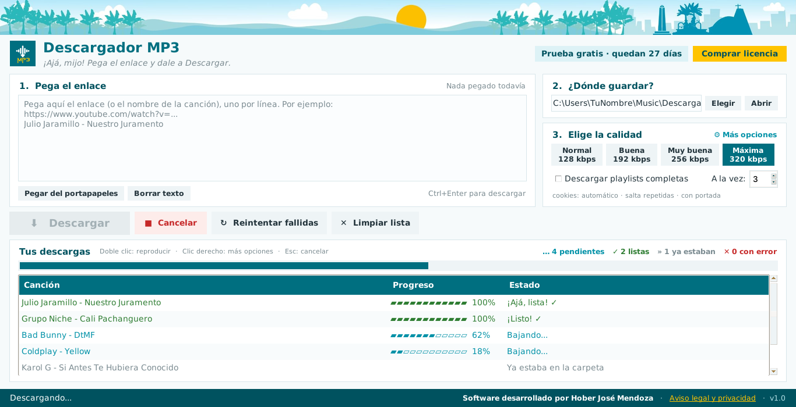

  

  

<h1 align="center">Descargador MP3</h1>

  <b>Pega el enlace, elige la calidad y descarga tu música en MP3.</b> 
  Para Windows y Mac · Sin anuncios · Hecho en Ecuador con toque manabita

  
  
  

  
  
  
  

<i>Incluye 30 días de prueba gratis con todas las funciones.</i>

---

  

## ✨ Lo que hace

- 🔗 **Pega uno o varios enlaces**, o escribe solo el nombre de la canción, y descárgalos todos de una vez.
- 🎚️ **Elige la calidad:** Normal (128), Buena (192), Muy buena (256) o Máxima (320 kbps).
- ⚡ **Varias descargas a la vez** (tú eliges cuántas), cada una con su barra de progreso.
- 🏷️ **Nombres limpios** tipo `Artista - Canción.mp3`, sin "(Official Video)" ni basura en el nombre.
- 🖼️ **Portada y datos incluidos:** la carátula, el artista y el título quedan guardados dentro del MP3, y se ven en tu celular, carro o reproductor.
- 🔁 **No repite:** salta las canciones que ya tienes en la carpeta.
- 📃 **Playlists completas**, con un solo enlace, si así lo quieres.
- ▶️ **Escucha al instante:** doble clic en una canción descargada para reproducirla.
- ♻️ **Reintenta las fallidas** con un botón, sin volver a pegar nada.
- 📁 **Tú eliges la carpeta** donde se guarda tu música, y la app la recuerda.
- 🔄 **Se actualiza sola** para seguir funcionando cuando cambian los sitios.
- 📦 **No necesitas instalar nada más:** todo viene incluido. Descargas, abres y listo.

## 🎯 Cómo se usa

1. **Pega el enlace** (o el nombre de la canción). Puedes poner varios, uno por línea.
2. **Elige dónde guardar.**
3. **Elige la calidad.**
4. Pulsa **Descargar** ⬇️ ... ¡y listo!

## 📥 Cómo instalarla

**¿Cuál descargo?**

| Tu computadora | Archivo |
|---|---|
| Windows 10 / 11 | [`DescargadorMP3-Windows.zip`](https://github.com/mendozaloorhober-cmd/descargador-mp3-descargas/releases/latest/download/DescargadorMP3-Windows.zip) |
| Mac de 2020 en adelante (chip M1, M2, M3, M4) | [`DescargadorMP3-Mac-AppleSilicon.dmg`](https://github.com/mendozaloorhober-cmd/descargador-mp3-descargas/releases/latest/download/DescargadorMP3-Mac-AppleSilicon.dmg) |
| Mac con procesador Intel | [`DescargadorMP3-Mac-Intel.dmg`](https://github.com/mendozaloorhober-cmd/descargador-mp3-descargas/releases/latest/download/DescargadorMP3-Mac-Intel.dmg) |

> En Mac, para saber cuál es el tuyo: menú  → **Acerca de esta Mac**. Si dice "Chip Apple M…", es el de chip M.

### Windows
1. Descarga el `.zip` y haz clic derecho → **Extraer todo**.
2. Abre la carpeta y haz doble clic en **Descargador MP3.exe**.
3. Si aparece *"Windows protegió su PC"*: **Más información** → **Ejecutar de todas formas**. Solo pasa la primera vez.

> Tip: clic derecho en el `.exe` → **Enviar a → Escritorio (crear acceso directo)**. No saques el `.exe` de su carpeta.

### Mac
1. Abre el `.dmg` y arrastra **Descargador MP3** a **Aplicaciones**.
2. La primera vez el Mac la bloquea porque no es de la App Store. Ábrela una vez, cierra el aviso y ve a **Ajustes del Sistema → Privacidad y seguridad → Abrir igualmente**.

## 💬 ¿Dudas o soporte?

📱 **WhatsApp:** [+593 96 275 3250](https://wa.me/593962753250?text=Hola%2C%20tengo%20una%20consulta%20sobre%20Descargador%20MP3) 
✉️ **Correo:** [mendozaloorhober@gmail.com](mailto:mendozaloorhober@gmail.com)

## ⚖️ Uso responsable

Usa Descargador MP3 solo con **música propia, de dominio público o con autorización** del titular de los derechos, y respeta las condiciones de las plataformas de donde la obtengas.

Lee el [Aviso legal y política de privacidad](AVISO_LEGAL.md).

---

  <b>Software desarrollado por Hober José Mendoza</b> 
  © Hober José Mendoza. Todos los derechos reservados.

